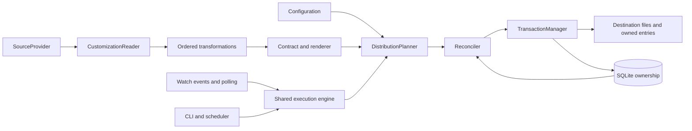

# Architecture

| Component | Module | Boundary |
|---|---|---|
| Configuration and defaults | `config`, `paths`, `catalog` | Typed policy and XDG storage |
| Local/Git snapshots | `sources` | Complete immutable snapshots |
| Package interpretation | `readers`, `models` | Shared semantics, retained metadata, and origins |
| Transformations/plugins | `transforms` | Ordered proposed collection changes |
| Harness policy | `contracts`, `hooks` | Discovery formats and explicit fidelity |
| Planning/orchestration | `engine`, `cache` | Combined desired state and target groups |
| Document edits | `documents` | JSON/JSONC/TOML/Markdown entry preservation |
| Ownership and comparison | `state`, `reconcile` | Managed outputs, drift, and deletion boundaries |
| Durable application | `transactions` | Preconditions, staging, journals, and rollback |
| Background/login | `watch`, `services`, `service_runner` | Same engine triggered by events, timers, or startup |
| Public interface | `cli`, `__main__`, `loggingutil` | CLI, versioned reports, and diagnostics |

Value objects are frozen dataclasses. Stateful services receive collaborators through constructors. Structural protocols define providers, readers, transformations, renderers, and reconciliation boundaries. Installed entry points and the executable JSON protocol extend the engine without bypassing ownership.

Caches store proposed conversion results, never permission to overwrite or delete. Journals include before-images and prior ownership. Supporting files and executable permissions travel with packages; credentials remain references.

See [extensions](extensions.md) for protocols and [reconciliation](reconciliation.md) for failure guarantees.
